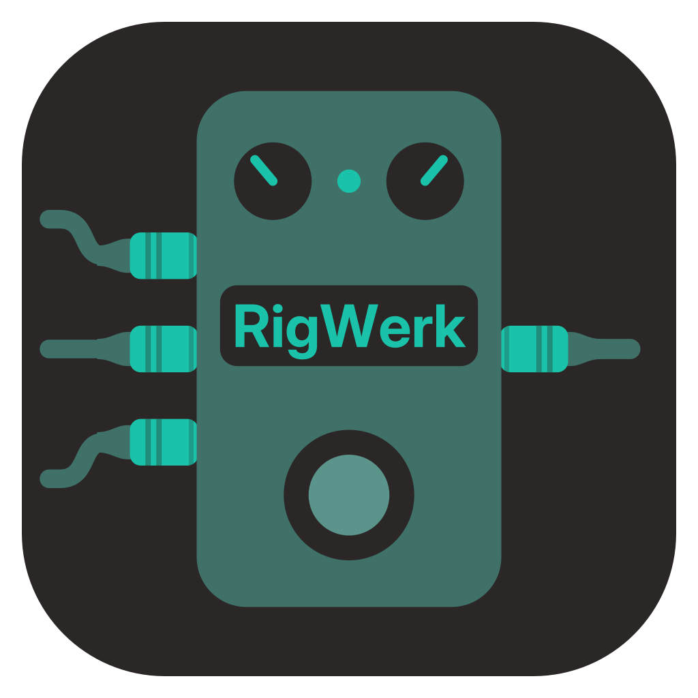
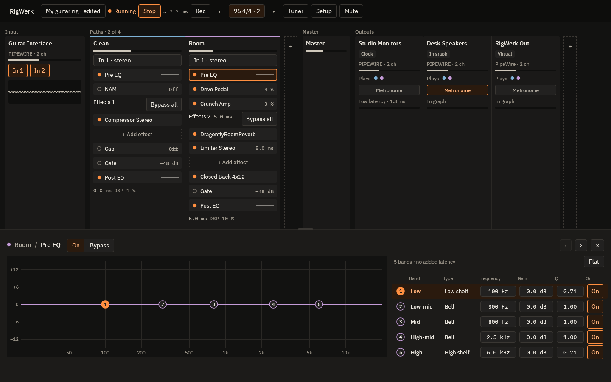
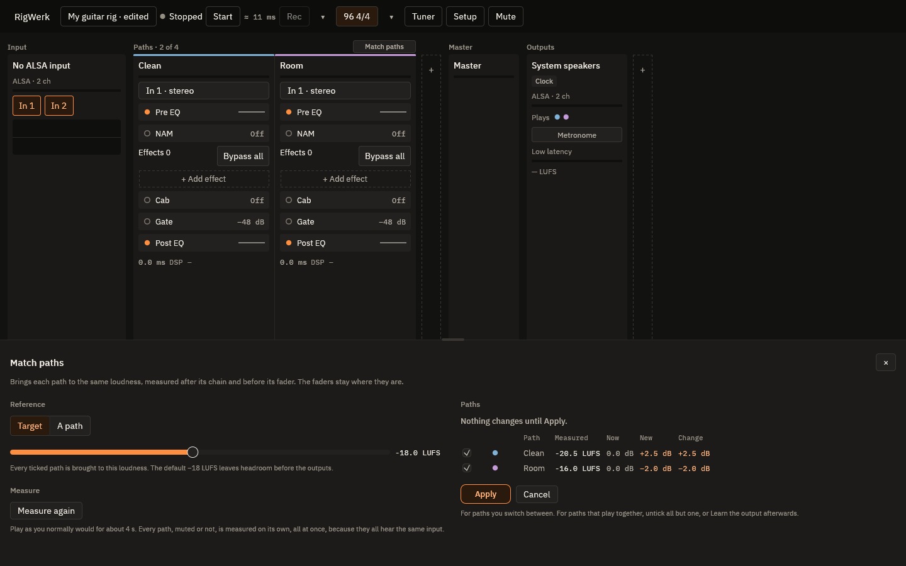
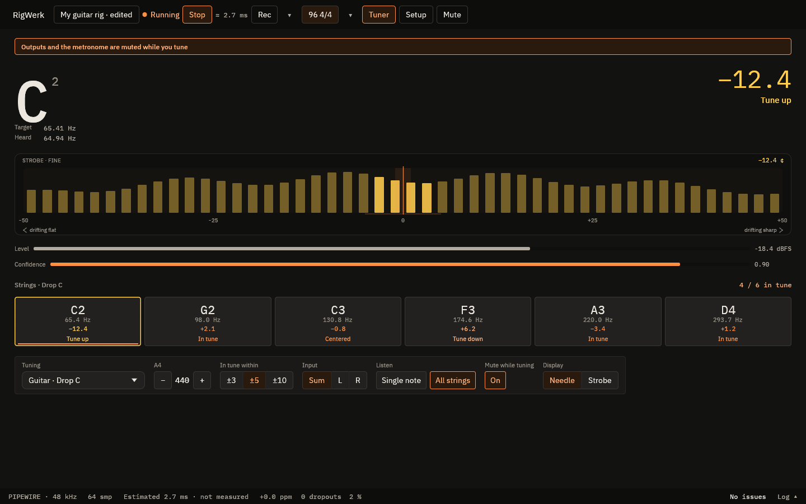

<p align="center">
  
</p>

# RigWerk

Run an audio interface through effects and out to any other device, even
when the two don't share a clock. Guitar into one interface, EQ, plugins
and a gate, then out to monitors, headphones and a stream at once.

Linux (PipeWire, ALSA) and Windows (ASIO, WASAPI). Alpha: expect rough
edges.


## Features

- **Any input to any output**, across clocks and sample rates, with drift
  correction.
- **Up to four paths**, each with EQ, VST3/CLAP/LV2 effects and a noise
  gate.
  Paths stay time-aligned on every output.  An effects return runs one
  reverb or delay on every path's sends.
- **Pitch shifter**, first in each path: drop or raise the whole guitar
  by up to an octave, with 4–40 ms of delay.  Built for single notes and
  power chords; full chords chorus, less with a longer delay.
- **NAM blocks.** Load Neural Amp Modeler `.nam` captures straight into a
  path and stack them, e.g. a drive pedal into an amp, with automatic level
  matching. No plugin needed.
- **Cab IRs.** Load a `.wav` impulse response per path, with level, low
  and high cut and polarity. No added latency.
- **Several outputs at once**, plus a virtual output other apps can record.
- **Low latency**, showing the rates and buffers the drivers really opened.
- **Safety limiter** on every output (−1 dBFS).
- **Tuner, metronome and recorder** built in.
- **Sessions** save and restore the whole setup.

The full tour of every screen is in the [manual](docs/manual.md).

## Screenshots

### EQ



### Output settings

Channel map, per-path level, polarity and timing on one output.


### Match paths

Each path is measured after its chain and brought to the same loudness
before its fader.



### Tuner



## Build and run

No release builds yet. With Rust 1.95 or newer:

```bash
cargo run --release
```

- **Linux:** X11 or Wayland, plus `libpipewire-0.3-dev` and
  `libasound2-dev` (Debian/Ubuntu). For the lowest latency with ALSA
  devices, join the `audio` group for real-time threads.
- **Windows:** MSVC toolchain. ASIO drivers are optional.

## Keys

| Key | Does |
| --- | --- |
| Ctrl+Shift+M | Mute the master |
| Ctrl+T | Tuner |
| Ctrl+, | Setup |
| Ctrl+S / Ctrl+Shift+S | Save session / save as new |
| Ctrl+F | Effect browser |
| Ctrl++ / Ctrl+− / Ctrl+0 | UI size |
| Esc | Close the top popup, sheet or screen |

## Development

```bash
cargo fmt --all -- --check
cargo clippy --all-targets -- -D warnings
cargo test --locked
```

Guidelines: [`AGENTS.md`](AGENTS.md). Known gaps:
[`docs/open-items.md`](docs/open-items.md). Screenshots:
[`docs/screenshots`](docs/screenshots/README.md).

## License

[GPL-3.0-or-later](LICENSE). Bundled fonts: IBM Plex subsets (renamed
RigWerk Sans/Mono) under the [OFL 1.1](assets/fonts/OFL.txt), and egui's
fallback fonts (Ubuntu Font Licence, MIT). `vendor/nam-rs`, nam-rs with
RigWerk's speedups, stays under its [MIT license](vendor/nam-rs/LICENSE).
VST3 and ASIO are Steinberg technology with their own terms.
