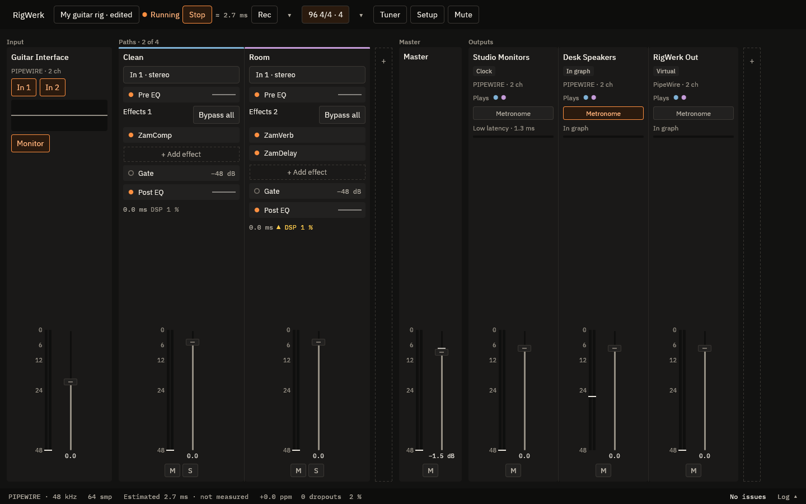
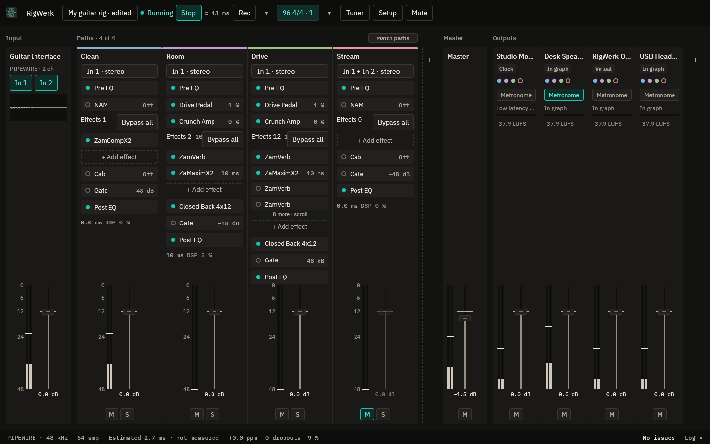
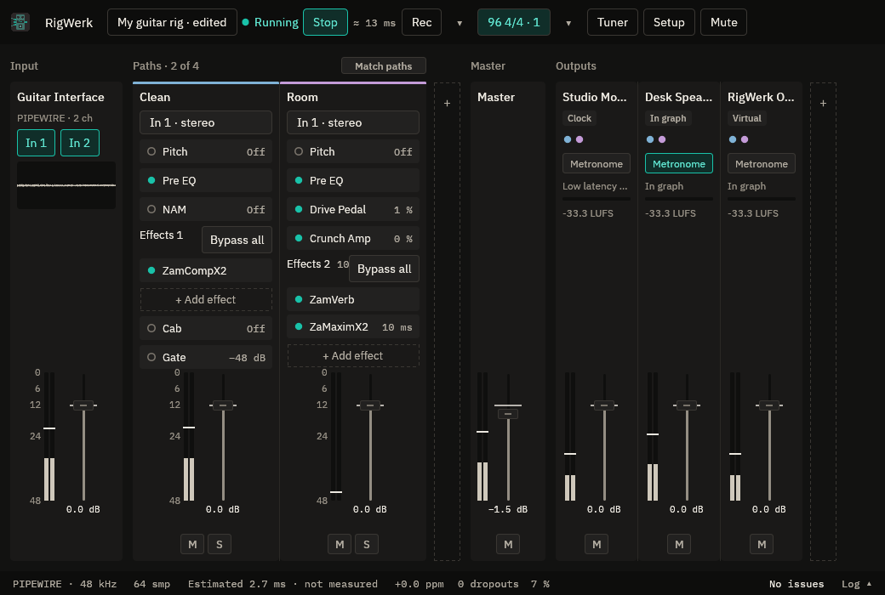
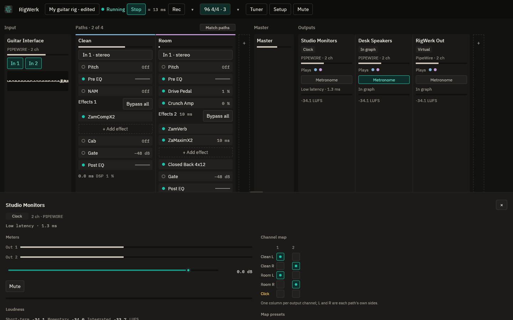
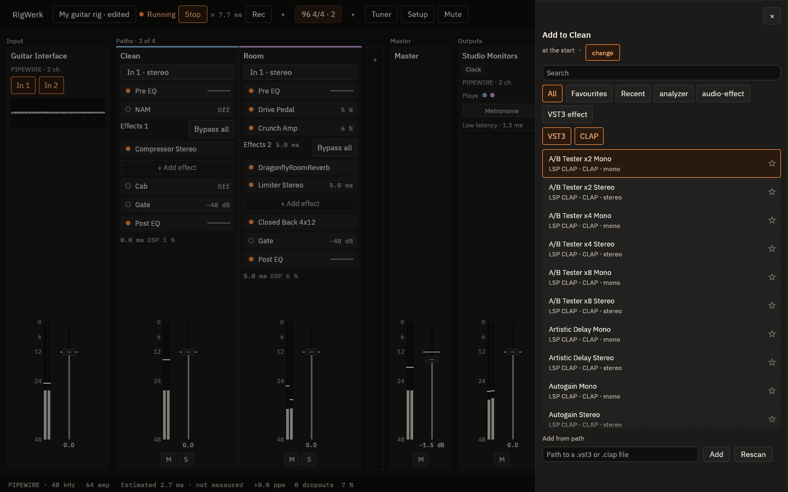
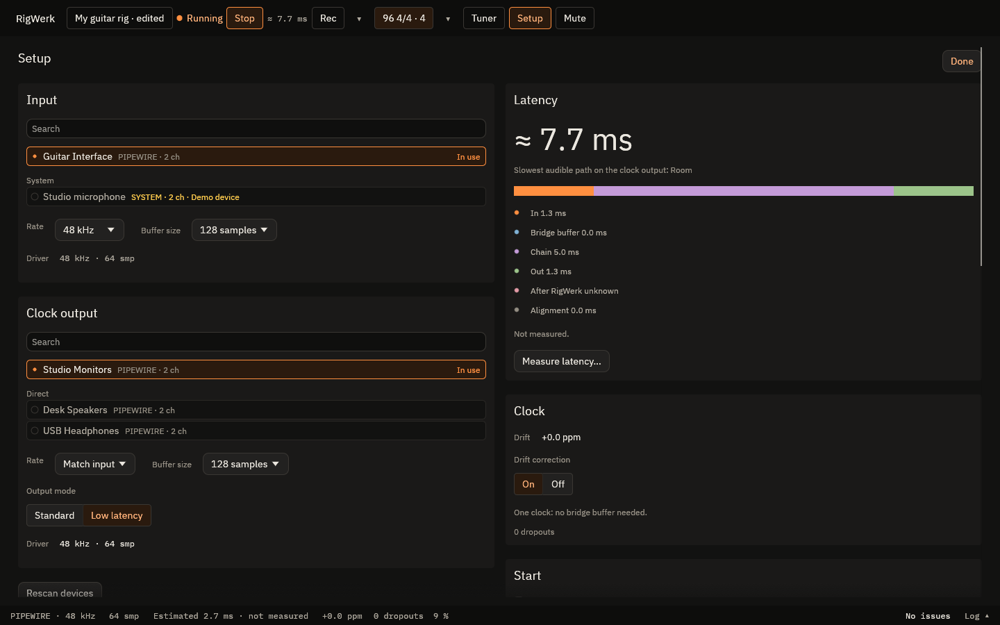
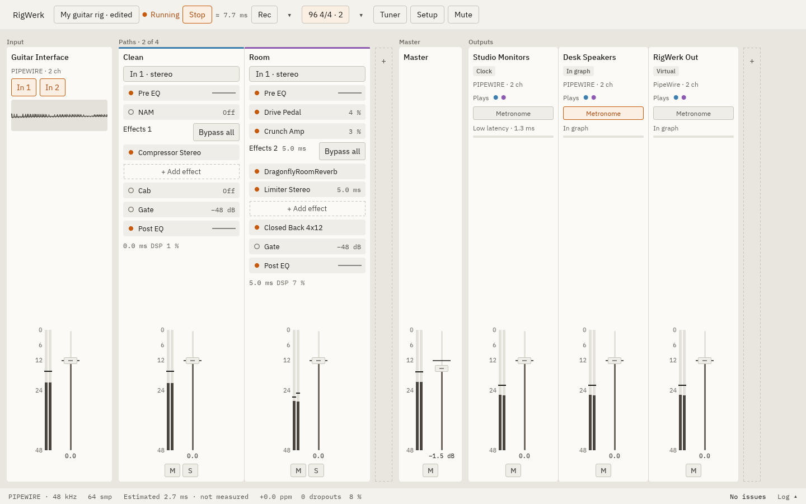

# RigWerk

Play an audio interface through effects and out to any other device, even
when the two don't share a clock. Plug a guitar into one interface, run it
through EQ, plugins and a noise gate, and hear it on your monitors,
headphones and stream at the same time.

RigWerk runs on Linux (PipeWire, or ALSA directly) and Windows (ASIO and
WASAPI). It is alpha software: expect rough edges and changes.

## What it does

- **Any input to any output.** Input and clock output can keep their own
  clocks and sample rates. RigWerk converts between them and corrects the
  slow drift.
- **Up to four paths**, each with its own chain of EQ, effects and gate,
  and its own source, level, mute and solo. Paths are kept in time with
  each other on every output.
- **VST3 and CLAP effects.** Up to 32 per path, bypassed one by one or all
  at once, opened in their own window or as a list of controls.
- **Several outputs at once.** The clock output plus up to four extra
  outputs, each extra with its own level, mute and bridge buffer, or a
  virtual output other apps record from.
- **Low latency when you want it**, with the rates, buffer sizes and
  output modes the drivers really use, not just the ones you asked for.
- **A safety limiter on every output**, so nothing goes past −1 dBFS.
- **A tuner, a metronome and a recorder** built in.
- **Sessions** to save and reload the whole setup.

## The console

The console is the home screen. The signal runs left to right — input,
paths, master, outputs — and every strip ends in a meter and a fader, so
levels line up across the screen.



**Title bar.** The session menu, bridge start and stop, the estimated
latency, Rec, the metronome, Tuner, Setup and Mute. The dot beside the
bridge reads *Stopped*, *Starting…*, *Running*, *Demo*, *Stopping…* or
*Error*.
**Ctrl+Shift+M** mutes the master from any RigWerk window.

**Input.** The device, driver and channel count; In 1 and In 2; monitor;
the scope; and the input gain. A click on the device opens Setup › Input.

**Paths.** Up to four, each with:

- a source: which input channels feed it, in stereo or summed to mono;
- a chain in signal order: Pre EQ, effects, gate (before or after the
  effects), Post EQ;
- its latency and DSP load;
- level, mute and solo.

The dashed column adds an empty path, a duplicate (muted), or applies a
starting layout: *Single path*, *Dry L / Wet R*, *Blend clean*, *Dual
amp*, *Per-output mixes*. A layout only changes routing; your effects stay
where they are. The path name menu renames a path, sets its colour,
duplicates it (muted) and removes it; path outputs (L, R) are in the path
sheet.



**Master.** One level and one mute for the sum of all paths.

**Outputs.** The clock output first, then the extra outputs. An output
shows which paths play on it (one dot per path), its metronome switch, its
buffer, a limiter reduction bar, one meter per channel, and its level and
mute. The dashed column adds another device, or the virtual output: on
Windows that is VB-Cable, on PipeWire it is RigWerk Out. An extra output
that fails stays silent and is retried; the clock output keeps playing.

At the 1040 × 700 minimum the strips get denser, and the paths group
scrolls sideways when not all four fit. Everything a narrow step hides
stays in that item's sheet.



**Status bar.** Drivers and rates, buffer sizes, the estimated and the
measured latency, drift, dropouts, total DSP load, and the newest log line
for five seconds. On the right, the issue count opens the issues drawer and
*Log* opens diagnostics. A click on the drivers, rates, buffers or latency
opens Setup at that section.

**Metronome.** Tempo (40–240 BPM), rhythm (4/4, 3/4, 6/8, 7/8 and other
common bars, with an accented downbeat) and click level. Each output picks
the channels the click plays on, so it can go to your headphones only. The
click is not part of the path mix, the scope or the meters, it keeps
ticking when the rig is muted, and it stops while the tuner mutes the
outputs. It always starts stopped.

**The bridge buffer.** When the input and the clock output run on different
clocks, RigWerk converts between them and holds a little audio in between:
the bridge buffer. It is *Auto*, *Minimum* or *Fixed* in Setup › Clock.
*Auto* grows after a dropout; *Fixed* sets the size in milliseconds. On a
single PipeWire graph clock nothing has to be held, and RigWerk says so.
The status bar shows drift and dropouts while the bridge runs.

**Keeping paths in time.** Effects such as amp sims and lookahead limiters
add delay. When two paths with different delays play on one output they
sound hollow (comb filtering), so RigWerk delays the faster paths to match
the slowest one there. Each output can turn this off when nothing is
summed on it, and each path has its own level, polarity and a small timing
trim per output. Paths are lined up within one output, not between
outputs, and only for delays up to about 0.7 s. A path cannot feed another
path; duplicate it instead.

## Sheets, drawers and diagnostics

Click a stage in a chain, a path name or an output to edit it in a sheet at
the bottom of the console. A sheet covers one thing at a time: EQ, gate,
effect, path, output or scope. It can be resized from its top edge and
moves through the chain with *‹ previous* and *next ›*. Esc closes it. The
title bar and status bar keep working while it is open, and each strip
shows a thin meter.

- **EQ** has five bands (low shelf, three bells, high shelf) with a curve
  and a band table, and a *Flat* button.
- **Gate** has threshold, range, hysteresis, attack, release and hold, a
  reduction meter, and *Before effects* / *After effects*.
- **Effect** has on/bypass, wet, latency, state, its controls, *Editor*,
  *Reset to defaults* and *Remove*.
- **Path** has name, colour, source, path outputs (which of the path's
  L and R play at all, before any output), level, mute, solo, duplicate,
  layouts and its latency on each output it plays on.
- **Output** has the channel map grid and its presets, the metronome
  channels, *Channels nothing plays* (mono copy or silent), and per path
  the level here, polarity, trim and when it arrives. The alignment switch
  and the bridge buffer of an extra output are here too.
- **Scope** shows input and output overlaid, with the peaks and the sample
  count.




The effects group opens the **effect browser** from its dashed *+ Add
effect* row, or from an empty chain, and the browser lists VST3 and CLAP
plugins found in the standard folders (and in `CLAP_PATH` or
`RIGWERK_CLAP_PATH` for CLAP).
Search by name, maker, format or category; a prefix match ranks first,
then favourites and recently used effects. ↑/↓ chooses, Enter adds,
Shift+Enter adds and opens the editor. *Add from path* and *Rescan* are in
the footer. Adding, removing or reordering effects does not stall the
audio.



The **issues drawer** opens from the status bar count. Each row says what
is wrong, what to do and where: *Show* closes the drawer and selects the
thing the issue points at, in the console or in Setup. Warnings that allow
it can be dismissed. Errors also show a banner under the title bar until
they clear or are dismissed; *Audio device disconnected* is one, with
*Rescan* and *Open Setup*.

The **diagnostics sheet** opens from *Log*. Its tabs are the activity log
(newest first; Copy and Export write it oldest first), performance (DSP
load per path and in total, skipped buffers, reset), the latency estimate
and the measurement's conditions, the scan notes, and the engine status
with the last error.

**Measure latency.** From Setup › Latency, *Measure latency…* plays a short
test click through a cable from the output back into the input, or through
a microphone in front of the speaker, and times its return. The clock
output is muted for the whole capture, not only while the click plays. The
result is a measurement; the estimate beside it is not. A stored result is
marked stale, with the reason, when the input, output, rate, buffer or
output mode changes.

## Tuner

The tuner is a full screen: *Tuner* in the title bar, or **Ctrl+T**; Esc
or Ctrl+T goes back. It shows the note very large, its octave, the target
and the heard frequency, and a needle or a strobe with ±50 cents and the
in-tune band. Level and confidence run underneath.

Pick Chromatic, or one of the 20 tunings (6, 7 and 8-string guitar; 4, 5
and 6-string bass). A tuning shows one cell per string with its note,
target frequency and cents, and reads every string from a single strum;
the string being played is underlined. The bottom bar sets the tuning, A4,
the in-tune tolerance (±3, ±5 or ±10 cents), the input channel (L, R or
Sum), *Listen* (single note or all strings), *Mute while tuning* and the
display (needle or strobe).

*Mute while tuning* silences the outputs and the metronome while the tuner
is open. Without a running bridge the tuner asks you to start it.


## Setup

Setup is one scrolling screen: **Ctrl+,** or *Setup*. *Done* returns to
the console.



On the left are the devices. **Input** lists direct drivers (ASIO,
PipeWire, ALSA `hw:`) and system ones (WASAPI, DirectSound, MME,
PulseAudio), with *In use* and *Demo device* marks, then its rate, buffer
size and the driver line, and *Driver panel* when it is ASIO. **Clock
output** has the same list, rate (*Match input* or a rate), buffer size and
output mode: *Standard* or *Low latency* on Linux, *Shared*, *Shared,
smallest buffer* or *Exclusive* on WASAPI. ASIO, DirectSound and MME have
no output mode; an ASIO clock output has *Driver panel* too. *Rescan
devices*, the PipeWire graph line and the driver note for this platform
sit at the bottom. On Windows the ASIO4ALL conflict warning shows here.

On the right:

- **Latency**: the estimate as a large number with its parts (*In*,
  *Bridge buffer*, *Chain*, *Out*, *After RigWerk*, *Alignment*), then the
  measured loopback with its rates, buffers, mode and age, and *Measure
  latency…*. The estimate covers the clock output's slowest audible path,
  alignment included.
- **Clock**: drift, *Drift correction*, the bridge buffer and dropouts.
- **Start**: *Start the bridge when RigWerk opens*.
- **Appearance**: theme *System*, *Dark* or *Light*, and size 80–150 %.
  *System* follows the desktop's setting, with dark as the fallback.
  **Ctrl++**, **Ctrl+−** and **Ctrl+0** change the size from any screen.
- **Effects**: whether a double-click opens the *Editor* or the
  *Controls*, the plugin folders that are scanned, and *Rescan plugins*.
- **Recordings**: the folder takes are written to.
- **Help**: the setup guide for this platform, as collapsible sections,
  and *About*.



## Sessions and recordings

A session stores the devices, rates, buffers, paths, effects, outputs and
the bridge buffer under a name. The session menu in the title bar lists
saved sessions with their rate, buffer and latency. *Save* (**Ctrl+S**)
updates the current name or adds it; *Save as new session*
(**Ctrl+Shift+S**) adds one under a new name; *Rename* and *Delete* are
there too, and *Start new session* names the current setup *Untitled
session* without changing it. When the setup differs from the saved
session of that name, the menu shows *edited*, and loading over it needs a
second click. Loading replaces the setup and reopens the devices. It
leaves the metronome and each output's click channels alone.

**Rec** records the clock output, or on Windows the virtual output when
there is one, after its level, limiter and mute, to a WAV file named after
the session. Writing happens on its own thread, so a slow disk does not
cause dropouts. The Rec menu shows the elapsed time, the lost samples and
the path of the last take. The folder is set in Setup › Recordings and
defaults to `Recordings` in your home folder.

## Keys

| Key | Does |
| --- | --- |
| Ctrl+Shift+M | Mute or unmute the master |
| Ctrl+T | Tuner, and back |
| Ctrl+, | Setup |
| Ctrl+S / Ctrl+Shift+S | Save session / save as new session |
| Ctrl+F | The effect browser for the selected path |
| Ctrl++ / Ctrl+− / Ctrl+0 | Size up, down, 100 % |
| Alt+↑ / Alt+↓ | Move the focused effect |
| Ctrl+Enter | Open the focused effect's editor |
| Esc | Close the innermost popup, measure window, drawer, sheet or the tuner |

## Install and run

There are no release builds yet; build from source with Rust 1.95 or newer:

```bash
cargo run --release
```

- **Linux** needs a desktop (X11 or Wayland) and the PipeWire and ALSA
  development packages (`libpipewire-0.3-dev`, `libasound2-dev` on
  Debian/Ubuntu).
- **Windows** needs the MSVC toolchain. ASIO drivers are optional.

For the lowest latency on Linux with direct ALSA devices, let your user run
real-time audio threads (usually by joining the `audio` group). Without it
RigWerk still works, just with less headroom. PipeWire devices don't need
this. Note that with real-time priority, a plugin chain that is too heavy
for your CPU can make the desktop stutter.

## Development

The minimum Rust version is pinned in `rust-toolchain.toml` (1.95.0, the
lowest that builds egui/eframe 0.37). Coding guidelines are in
[`AGENTS.md`](AGENTS.md).

```bash
cargo fmt --all -- --check
cargo clippy --all-targets -- -D warnings
cargo test --locked
```

Tests that open real hardware are `#[ignore]` and only play silence.

The README screenshots and how to retake them are described in
[`docs/screenshots`](docs/screenshots/README.md); the images there date
from the previous sidebar layout and the new set is still to be taken.
Known gaps and limits are in [`docs/open-items.md`](docs/open-items.md).

## License

RigWerk is free software under the [GNU General Public License v3](LICENSE)
(or, at your option, any later version).

Third-party crates keep their own licenses (mostly MIT / Apache-2.0). System
libraries such as PipeWire and ALSA are typically LGPL and are linked
dynamically.

### Bundled fonts

The UI is set in IBM Plex Sans and IBM Plex Mono, under the
[SIL Open Font License 1.1](assets/fonts/OFL.txt).  `assets/fonts` holds
subsets of them, renamed RigWerk Sans and RigWerk Mono because “Plex” is a
Reserved Font Name; its [README](assets/fonts/README.md) gives the source
and version.

Behind them, as the fallback, the UI embeds egui’s default fonts from
`epaint_default_fonts`:

| Font | License |
| --- | --- |
| **Ubuntu Light** | [Ubuntu Font Licence 1.0](https://ubuntu.com/legal/font-licence) |
| **Hack Regular** | MIT (Source Foundry), with Bitstream Vera / DejaVu lineage |
| **egui icons** | subset of emoji-icon-font (MIT) |

Ubuntu Light remains under the Ubuntu Font Licence; Hack under MIT / Bitstream
Vera. The font files are not dual-licensed as GPLv3 — only the RigWerk source
around them is. Full texts ship with the `epaint_default_fonts` crate
(`OFL.txt`, `UFL.txt`, `Hack-Regular.txt`).

### Plugin formats

VST3 and ASIO involve Steinberg technology beyond the Rust crate SPDX lines.
Hosting a VST3 or talking to an ASIO driver may require agreeing to Steinberg’s
own terms; that is separate from this GPLv3 grant.
