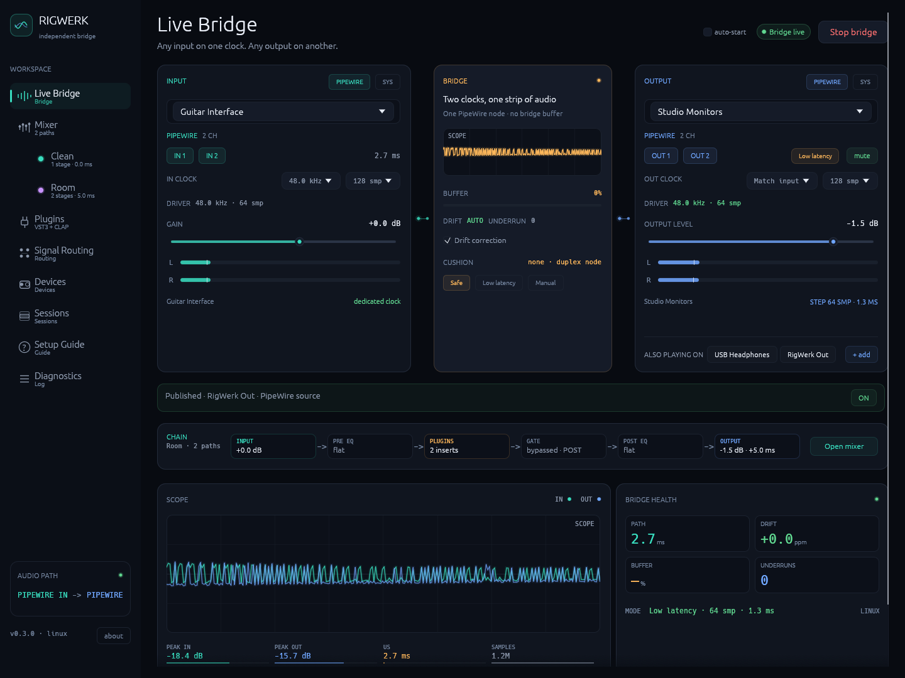
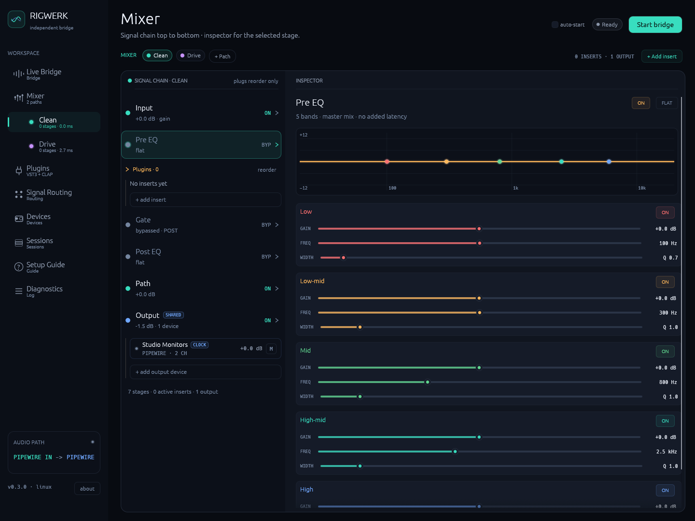
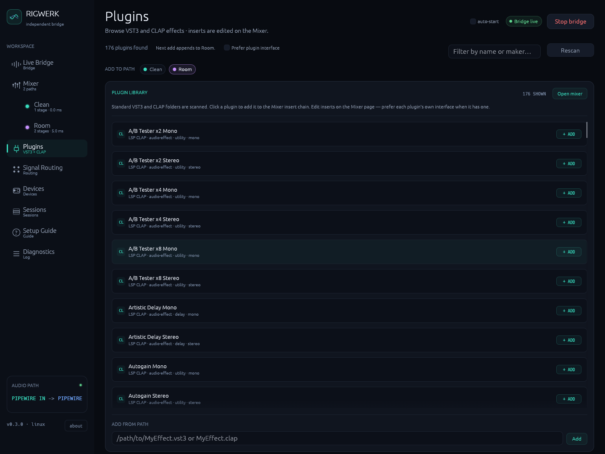
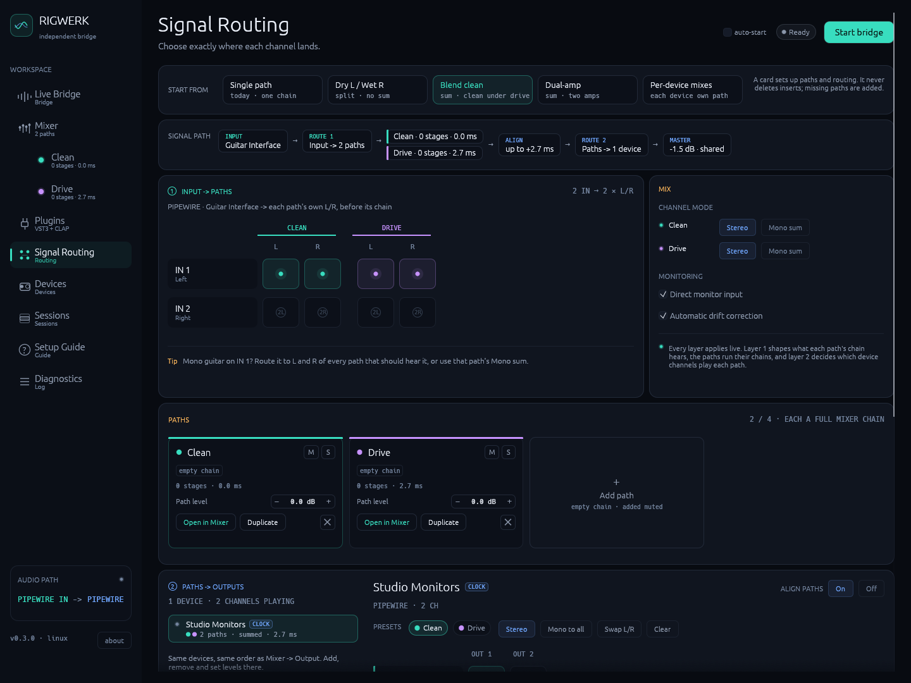
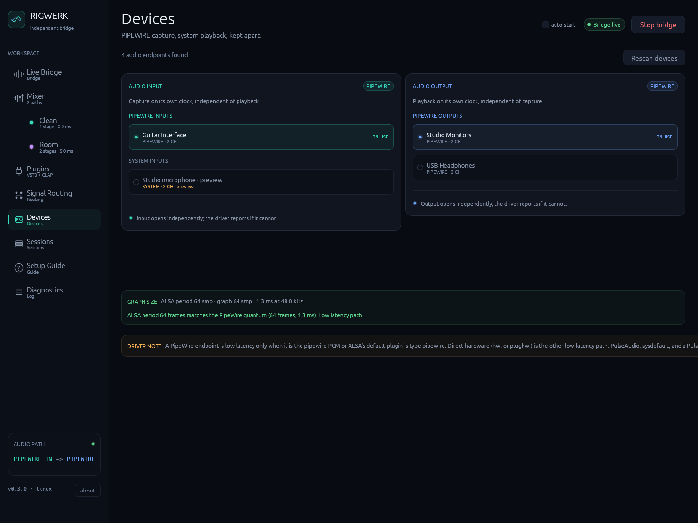

# RigWerk

Play an audio interface through effects and out to any other device, even
when the two don't share a clock. Plug a guitar into one interface, run it
through EQ, plugins and a noise gate, and hear it on your monitors,
headphones and stream at the same time.

RigWerk runs on Linux (PipeWire, or ALSA directly) and Windows (ASIO and
WASAPI). It is alpha software: expect rough edges and changes.

## What it does

- **Any input to any output.** Input and output keep their own clocks and
  sample rates. RigWerk converts between them and corrects the slow drift.
- **Effects.** EQ, VST3 and CLAP plugins, and a noise gate.
- **Several outputs at once.** Play on extra devices, or publish the mix
  for other apps to record.
- **Up to four signal paths**, each with its own effects, kept in time
  with each other.
- **Low latency when you want it**, with the real buffer sizes shown, not
  just the ones you asked for.
- **Sessions** to save and reload your whole setup.

## A quick tour

The sidebar has one page per task. In order:

### Live Bridge

Pick the input and output, start the bridge, and watch it run: level
meters, a scope, the latency you hear, drift and dropouts. The output can
run in a low latency mode (on Windows: shared, low-latency shared or
exclusive WASAPI), and a driver check shows the buffer the device actually
uses.

The health card also keeps the last **measured** loopback. **Measure…**
plays a short click through a cable from the output back into the input
(or a microphone in front of the speaker), hears it return and reports the
loopback's delay with the rates, buffers and output mode it was measured
under. That is a measurement; the PATH and HEARD tiles above it stay
estimates. A stored result is marked stale, with the reason, when the
input, output, rate, buffer or output mode changes. The main output is
muted for the whole short capture, not only while the click plays.

When something needs attention, an Issues strip appears at the top and says
what is wrong and what to do: a path nobody hears, a chain too heavy for
the buffer, an output that went quiet. Tick auto-start to start the bridge
when RigWerk opens.



### Mixer

The signal chain from top to bottom: input gain, EQ, plugins, noise gate,
EQ, path level and output. Click a stage to edit it on the right. Plugins
can be bypassed, reordered and mixed with the dry signal, and open either
in their own window or as a list of parameters.

The Output stage lists every device that plays the mix. Add extra outputs
here, each with its own level, mute and safety buffer (Safe, Low latency or
Manual), or add RigWerk Out to publish the mix as a source other apps can
record (on Windows this needs a virtual cable such as VB-Audio Cable). If
an extra output drops out, the rest keep playing and RigWerk keeps trying
to reopen it.



### Plugins

The library of VST3 and CLAP effects found in the standard folders. Search
it, add an effect to a path with one click, or add one by file path.



### Signal Routing

Which input channels feed each path, and which output channels play each
path. Paths can run in stereo or sum to mono (handy for a guitar on one
input).

A path is its own effects chain: EQ, plugins, gate and level. Run up to
four side by side on the same input and send each one to any outputs. For
example, put a clean and a distorted amp on the same guitar and blend them,
or send a limited mix to your stream and an unlimited one to your monitors.

Presets at the top get you started:

- **Single path**: one chain, nothing extra.
- **Dry L / Wet R**: one path on the left, another on the right.
- **Blend clean**: a clean copy 6 dB under the main path.
- **Dual-amp**: two copies summed, one with its polarity flipped, so each
  can get a different amp sim.
- **Per-device mixes**: one path on the main output, another on every
  other output.

Presets only change routing; your plugins stay where they are.

**Keeping paths in time.** Plugins such as amp sims and lookahead limiters
add delay. When two paths with different delays play on the same output,
they sound hollow (comb filtering). So RigWerk delays the faster paths to
match the slowest one on that output. Signal Routing shows how much each
output waits, and you can turn this off per output when nothing is summed
there. Each path also has its own level, polarity and a small timing trim
per output.

Limits: paths are lined up within one output, not between outputs, and only
for plugin delays up to about 0.7 s. A path can't feed another path
(duplicate it instead).



### Devices

Every input and output RigWerk found, and which ones are in use. New and
removed devices show up on their own. If the main input or output is
unplugged while running, the bridge stops and tells you. On Linux this page
also checks that the ALSA buffer matches PipeWire's, since a mismatch adds
latency.



### Sessions, Setup Guide and Diagnostics

- **Sessions** saves everything (devices, levels, routing, EQ, gate, plugins
  and their settings, paths) under a name, to load again later.
- **Setup Guide** walks through a first setup, with notes for Linux and
  Windows.
- **Diagnostics** has the activity log, how much of each audio buffer every
  path's effects use, and the latency budget: each part of the path (input
  block, bridge cushion, plugin chain, output step, the delay after
  RigWerk's playback node) with where its number comes from, the estimate
  those add up to, and the last measured loopback with its date and
  conditions. The measurement and the estimate cover different legs of the
  path, so they are shown side by side rather than subtracted. Copy and
  Export include the same breakdown.

## Install and run

There are no release builds yet; build from source with Rust 1.95 or newer:

```bash
cargo run --release
```

- **Linux** needs a desktop (X11 or Wayland) and the PipeWire and ALSA
  development packages (`libpipewire-0.3-dev`, `libasound2-dev` on
  Debian/Ubuntu).
- **Windows** needs the MSVC toolchain. ASIO drivers are optional.

For the lowest latency on Linux with direct ALSA devices, let your user run
real-time audio threads (usually by joining the `audio` group). Without it
RigWerk still works, just with less headroom. PipeWire devices don't need
this. Note that with real-time priority, a plugin chain that is too heavy
for your CPU can make the desktop stutter.

## Development

The minimum Rust version is pinned in `rust-toolchain.toml` (1.95.0, the
lowest that builds egui/eframe 0.37). Coding guidelines are in
[`AGENTS.md`](AGENTS.md).

```bash
cargo test
```

The README screenshots and how to retake them are described in
[`docs/screenshots`](docs/screenshots/README.md).

## License

RigWerk is free software under the [GNU General Public License v3](LICENSE)
(or, at your option, any later version).

Third-party crates keep their own licenses (mostly MIT / Apache-2.0). System
libraries such as PipeWire and ALSA are typically LGPL and are linked
dynamically.

### Bundled fonts (egui)

The UI embeds egui’s default fonts from `epaint_default_fonts`:

| Font | License |
| --- | --- |
| **Ubuntu Light** | [Ubuntu Font Licence 1.0](https://ubuntu.com/legal/font-licence) |
| **Hack Regular** | MIT (Source Foundry), with Bitstream Vera / DejaVu lineage |
| **egui icons** | subset of emoji-icon-font (MIT) |

Ubuntu Light remains under the Ubuntu Font Licence; Hack under MIT / Bitstream
Vera. The font files are not dual-licensed as GPLv3 — only the RigWerk source
around them is. Full texts ship with the `epaint_default_fonts` crate
(`OFL.txt`, `UFL.txt`, `Hack-Regular.txt`).

### Plugin formats

VST3 and ASIO involve Steinberg technology beyond the Rust crate SPDX lines.
Hosting a VST3 or talking to an ASIO driver may require agreeing to Steinberg’s
own terms; that is separate from this GPLv3 grant.
